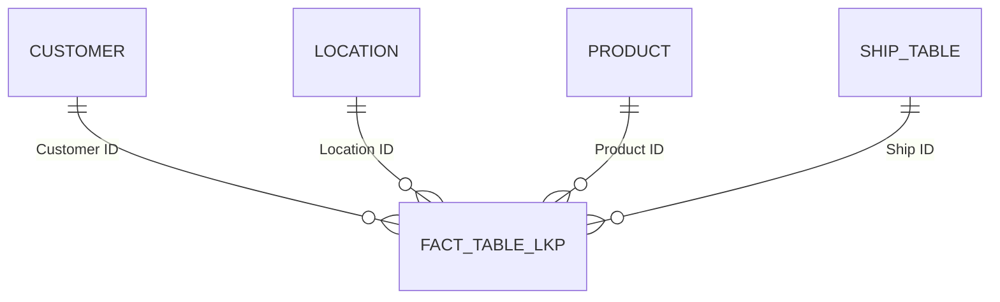
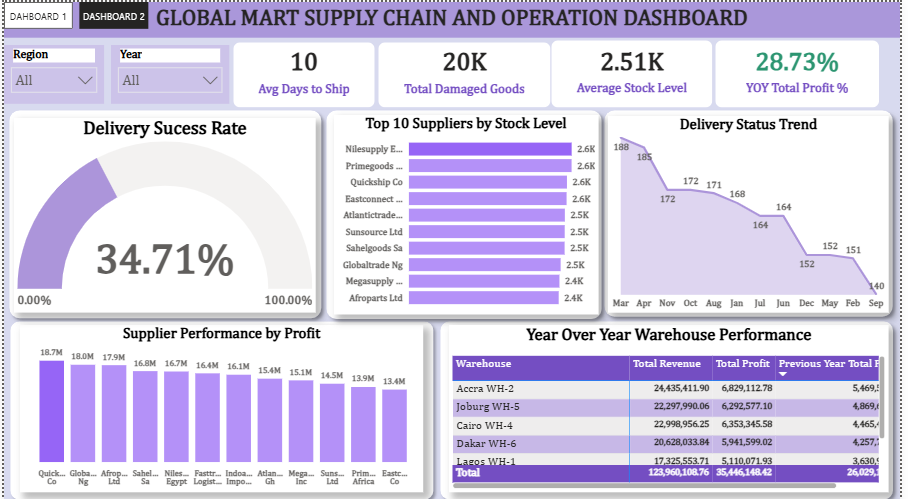
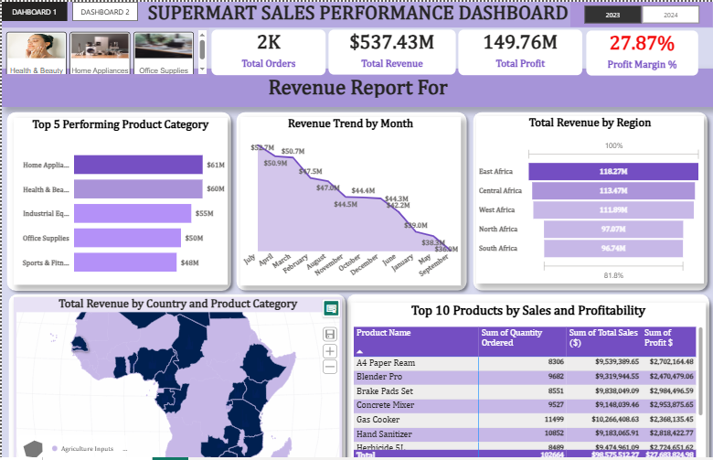

#  GlobalMart Sales & Supply Chain Performance Dashboard

An end-to-end Power BI project that cleans a messy multi-country retail dataset and turns it into an executive dashboard for monitoring revenue, profitability, delivery reliability, and damaged goods across five African regions. Built as the **AnalystLab Africa Week 2 Business Intelligence case study**.

---

## Table of Contents

1. [Project Overview](#-project-overview)
2. [Business Problem](#-business-problem)
3. [Project Objectives](#-project-objectives)
4. [Datasets](#-datasets)
5. [Data Preparation & Cleaning](#-data-preparation--cleaning)
6. [Dashboard Preview](#-dashboard-preview)
7. [KPIs](#-kpis)
8. [Business Questions & Insights](#-business-questions--insights)
9. [Business Insight](#-business-insight)
10. [Strategic Recommendations](#-strategic-recommendations)
11. [Future Improvements](#-future-improvements)

---

##  Project Overview

This project is a two-page Power BI report built on a cleaned star-schema data model:

- **Page 1 - Delivery & Operations:** On-time and late delivery rates, average shipping time, damaged goods rate, delivery volume over time, and stock level versus quantity ordered by category.
- **Page 2 - Revenue & Profitability:** Revenue, profit, profit margin, orders, and average order value, with revenue and profit by category, revenue share by region, and a monthly revenue trend.

Both pages can be filtered by **Region**, **Product Category**, and **Shipping Mode**, so stakeholders can move from a company-wide view down to a single region or category.

## Business Problem

The business captures sales, shipping, and stock records in one raw, inconsistent export: dates in mixed formats, region and delivery labels spelled several different ways, duplicate orders, and placeholder values in numeric fields. In that state, management cannot reliably answer basic questions such as:

- Which regions, categories, and customers drive revenue and profit?
- Are shipments arriving on time, and how much stock is being damaged?
- How is performance trending over time?
- Where should the business invest or intervene first?

Without clean, consolidated data, decisions on regional strategy, delivery performance, and inventory were being made on guesswork.

##  Project Objectives

- Import, inspect, and clean the raw GlobalMart dataset in Power Query.
- Model the data as a star schema (one fact table, four dimension tables) with reusable DAX measures.
- Track the core KPIs: Total Revenue, Total Profit, Total Orders, Average Order Value, and Profit Margin.
- Monitor delivery health: on-time rate, late rate, shipping time, and damaged goods rate.
- Compare performance across regions, product categories, and time.
- Turn the findings into insights, risks, opportunities, and actionable recommendations.

## Datasets

**Source:** `GlobalMart_Raw_Dataset.xlsx`, sheet *Raw Dataset (Messy)*, imported into Power BI with Power Query.

**Raw columns (22):** Order ID, Order Date, Ship Date, Customer Name, Region, Country, Product Category, Product Name, Supplier, Quantity Ordered, Unit Cost ($), Unit Price ($), Total Sales ($), Total Cost ($), Profit ($), Shipping Mode, Delivery Status, Days to Ship, Warehouse, Stock Level, Damaged Goods, Notes.

**After cleaning:**

| Item | Count |
|---|---|
| Unique orders | 1,959 |
| Order period | 1 Jan 2023 – 28 Dec 2024 |
| Regions | 5 (East, West, Central, North, Southern Africa) |
| Product categories | 10 |
| Customers | 1,766 |
| Units ordered | 802,192 |

##  Data Preparation & Cleaning

All cleaning was done in **Power Query** before modelling. The table below lists each problem found in the raw data and the step used to fix it.

| # | Problem in the raw data | Fix applied in Power Query |
|---|---|---|
| 1 | File imported with generic column types | Promoted the first row to headers and set explicit types: text for IDs and labels, whole number for Quantity Ordered, Days to Ship and Damaged Goods, decimal for prices, sales, and costs. |
| 2 | Order Date and Ship Date stored as text in mixed formats | Added custom columns using `Date.FromText`, trying the UK format (`en-GB`) first, then the US format (`en-US`), otherwise null. Changed the result to Date type, then replaced the original text columns. |
| 3 | Duplicate order records | Removed duplicates on **Order ID**, keeping one row per order. |
| 4 | Inconsistent casing, stray spaces, and hidden characters | Applied **Text.Proper**, **Text.Trim**, and **Text.Clean** to Customer Name, Region, Country, Product Category, Product Name, Supplier, Shipping Mode, Delivery Status, and Warehouse. |
| 5 | Region spelled many ways | Conditional column mapping *C. Africa / C.Africa / Centralafrica* → **Central Africa**; *E.Africa / Eastafrica* → **East Africa**; *N.Africa / Northafrica* → **North Africa**; *W. Africa / West-Africa / Westafrica* → **West Africa**; *South Africa Region* → **Southern Africa**. |
| 6 | Delivery Status spelled many ways, with gaps | Mapped *L8 / Late Delivery* → **Late** and *On-Time / Ontime* → **On Time**, then used **Fill Down** to complete blank statuses. |
| 7 | Shipping Mode abbreviations | Mapped *Eco → Economy*, *Exp → Express*, *O/N → Overnight*, *Std → Standard*. |
| 8 | Missing Product Name, Supplier, and Customer Name | Replaced nulls with **Unknown Product Name**, **Unknown Supplier**, and **Unknown Customer** so no rows are lost in grouping. |
| 9 | Missing Damaged Goods values | Replaced nulls with **0**. |
| 10 | Placeholder text in Stock Level (`?`, `#ERROR`, `--`, `N/A`, `n.a.`) | Converted all placeholders to **null** instead of guessing a value, then set the column to a number type. |
| 11 | Free-text Notes column adds no analytical value | Removed the **Notes** column and the original, superseded columns. |

### Data model (star schema)

After cleaning, the data was split into one fact table and four dimension tables, joined with surrogate keys generated in Power Query (merge queries, expand the key, remove the descriptive columns).

| Table | Role | Grain / key columns |
|---|---|---|
| **Fact Table Lkp** | Fact | One row per order: Order ID, Order Date, Ship Date, Days to Ship, Quantity Ordered, Total Sales, Total Cost, Stock Level, Damaged Goods, plus the four foreign keys |
| **Customer** | Dimension | Customer ID, Customer Name |
| **Location** | Dimension | Location ID, one row per Region (with a representative Country) |
| **Product** | Dimension | Product ID, one row per Product Category (with a representative Product Name and Supplier) |
| **Ship Table** | Dimension | Ship ID, one row per Delivery Status (with its Shipping Mode and Warehouse) |
| **Aggregations** | Measure table | Holds all DAX measures |

All four relationships are many-to-one with single-direction filtering.

**Calculated columns:** `Unit Cost = Total Cost ÷ Quantity`, `Unit Price = Total Sales ÷ Quantity`, `Profit = Total Sales − Total Cost`.

**DAX measures:**

| Measure | Definition |
|---|---|
| Total Revenue | `SUM(Total Sales)` |
| Total Profit | `SUM(Profit)` |
| Profit Margin % | `DIVIDE([Total Profit], [Total Revenue])` |
| Total Orders | `DISTINCTCOUNT(Order ID)` |
| AOV (Average Order Value / Average Sales) | `DIVIDE([Total Revenue], [Total Orders])` |
| Total Deliveries | `COUNTROWS(Fact Table Lkp)` |
| On-Time Deliveries / On-Time Dlv Rate % | Rows where Delivery Status = "On Time" ÷ Total Deliveries |
| Late Deliveries / Late Dlv Rate % | Rows where Delivery Status = "Late" ÷ Total Deliveries |
| Average Shipping Time | Rounded average of Days to Ship, shown as "N Days" |
| Total Damaged Goods | `SUM(Damaged Goods)` |
| Total Qty Ordered | `SUM(Quantity Ordered)` |
| Damaged Goods Rate % | `DIVIDE([Total Damaged Goods], [Total Qty Ordered])` |

### Data quality notes

Checks run on the cleaned model surfaced a few items worth knowing when reading the figures:

- **Days to Ship** has 13 invalid values (8 negative, 5 between 500 and 999). They lift the average from **8.0 days** (1,946 valid orders) to **10.2 days**, so the dashboard card is slightly overstated.
- **Ship Date** is earlier than Order Date on about half of the rows, a side effect of ambiguous day/month formats in the source. For that reason, trends in this document use **Order Date**, and shipping time uses the source *Days to Ship* field.
- **Stock Level** is blank for 26 orders (placeholders converted to null), so stock averages exclude them.
- **13 orders** had no customer name and are grouped under a single *Unknown Customer* ID.
- **2024 volume** is about 72% lower than 2023 across every region and category (see Q6), which looks more like an incomplete extract than a real market decline and should be validated at the source.

## Dashboard Preview

### Page 1 - Delivery & Operations

### Page 2 - Revenue & Profitability

**Visuals on each page**

| Page | Visual | Type |
|---|---|---|
| 1 | Delivery KPI cards (On-Time %, Late %, Avg Shipping Time, Damaged Goods %) | Card |
| 1 | Late delivery rate by supplier | Bar chart |
| 1 | On-time rate by shipping mode | Column chart |
| 1 | Deliveries by month | Line chart |
| 1 | Damaged goods rate by category | Bar chart |
| 1 | Stock level vs quantity ordered by category | Bar chart |
| 2 | Revenue KPI cards (Revenue, Profit, Margin %, Orders, AOV) | Card |
| 2 | Revenue and profit by category | Bar chart |
| 2 | Profit margin % by category | Bar chart |
| 2 | Revenue trend by month | Line chart |
| 2 | Revenue by region | Donut chart |
| 2 | Profit by supplier | Column chart |
| Both | Region, Product Category, Shipping Mode | Slicers |

##  KPIs

*All figures cover 2023–2024 and all regions (no filters applied).*

**Revenue & Profitability**

| KPI | Value |
|---|---|
| Total Revenue | $684.63M |
| Total Profit | $190.54M |
| Profit Margin % | 27.83% |
| Total Orders | 1,959 |
| Average Order Value (Average Sales) | $349.5K |

**Delivery & Operations**

| KPI | Value |
|---|---|
| On-Time Delivery Rate | 34.66% |
| Late Delivery Rate | 65.14% |
| Average Shipping Time | 10.2 days (8.0 days excluding 13 invalid values) |
| Total Damaged Goods | 19,975 units |
| Damaged Goods Rate | 2.49% of units ordered |

##  Business Questions & Insights

**1. What is the overall sales performance of the company?**
The business generated **$684.63M in revenue and $190.54M in profit** (27.83% margin) from 1,959 orders, with an average order value of $349.5K and 802K units shipped. 2023 delivered $531.26M from 1,531 orders and 2024 delivered $153.37M from 428 orders. The margin is almost identical in both years (27.84% vs 27.81%).

**2. Which regions generate the highest sales and profit?**

| Region | Revenue | Profit | Margin | Share of revenue |
|---|---|---|---|---|
| East Africa | $152.49M | $43.25M | 28.36% | 22.3% |
| Central Africa | $143.95M | $40.17M | 27.90% | 21.0% |
| West Africa | $137.90M | $37.80M | 27.41% | 20.1% |
| North Africa | $128.59M | $35.62M | 27.70% | 18.8% |
| Southern Africa | $121.71M | $33.71M | 27.70% | 17.8% |

East Africa leads on both revenue and profit and has the best margin. Southern Africa is last, trailing East Africa by $30.8M (about 25%), with the lowest average order value ($329K).

**3. Which customer segments contribute the most revenue?**
The dataset has **no customer segment field** (only an anonymised customer name), so a true segment split isn't possible. Two proxies from the data show where revenue comes from:
- **By order size:** the 532 orders above $500K (27% of orders) generate **59.2% of revenue**; orders of $200K–$500K add another 31.2%. Orders under $50K contribute only 1%.
- **By customer value:** the top 10% of customers (176) account for 29.5% of revenue, and no single customer exceeds 1%, so revenue is not concentrated in a few accounts. However, only **9.6% of customers (170 of 1,766) ordered more than once**.

**4. Which product categories perform best?**

| Category | Revenue | Profit | Margin |
|---|---|---|---|
| Health & Beauty | $81.38M | $23.40M | 28.75% |
| Food & Beverages | $77.41M | $22.07M | 28.51% |
| Home Appliances | $74.49M | $20.22M | 27.15% |
| Agriculture Inputs | $71.04M | $19.68M | 27.70% |
| Clothing | $70.87M | $19.55M | 27.58% |
| Office Supplies | $65.79M | $17.68M | 26.87% |
| Industrial Equipment | $64.02M | $17.80M | 27.81% |
| Automotive Parts | $61.33M | $17.01M | 27.73% |
| Electronics | $59.63M | $17.13M | 28.72% |
| Sports & Fitness | $58.68M | $16.01M | 27.29% |

Health & Beauty, Food & Beverages, and Home Appliances together deliver 34.1% of revenue. Health & Beauty and Electronics have the highest margins; Office Supplies has the lowest.

**5. Which products are the most profitable?**
Product Category is the lowest product level the current model supports, so the answer is at category level: **Health & Beauty ($23.40M)**, **Food & Beverages ($22.07M)**, and **Home Appliances ($20.22M)** earn the most profit in absolute terms. On margin, **Health & Beauty (28.75%)**, **Electronics (28.72%)**, and **Food & Beverages (28.51%)** are the most profitable per dollar sold.

**6. What trends can be observed over time?**
- **Seasonality in 2023:** monthly revenue peaked in **July ($51.5M)**, with strong March ($50.5M) and April ($49.9M), and dipped in **September ($35.7M)**, May ($38.3M), and January ($38.5M).
- **A sharp drop in 2024:** quarterly revenue fell from about $130–136M in each 2023 quarter to $33–48M in each 2024 quarter, and orders fell 72% (1,531 to 428). The drop is uniform across all five regions (−68% to −75%) and all ten categories, starting right at January 2024, which points to an incomplete 2024 data load rather than genuine demand loss. This should be confirmed with the data owner before YoY conclusions are drawn.
- **Delivery has not improved:** the on-time rate was 34.2% in 2023 and 36.2% in 2024, and the damaged goods rate held at about 2.5% in both years.

##  Business Insight

### Five key insights

1. **Profitability is healthy and very stable.** The 27.83% margin barely moves between years (27.84% vs 27.81%), and every region (27.4%–28.4%) and category (26.9%–28.8%) sits in a narrow band, so profit growth will come from volume, not pricing.
2. **Revenue is well diversified.** No category exceeds 11.9% of revenue, no region exceeds 22.3%, and no customer exceeds 1%, so the business isn't dependent on any single category, region, or account.
3. **East Africa leads and Southern Africa lags.** East Africa earns $152.5M against Southern Africa's $121.7M (a 25% gap), and Southern Africa also has the lowest average order value ($329K) and the highest late-delivery rate (67.0%).
4. **Delivery reliability is the weakest area, and it is systemic.** Only 34.66% of orders arrive on time, and every region sits between 32.7% and 35.5%, which points to a company-wide process issue rather than a local one.
5. **Large orders carry the business, and customers rarely come back.** Orders above $500K make up 27% of orders but 59.2% of revenue, while 90.4% of customers (1,596) placed just one order.

### Three business risks

1. **Late deliveries (65.14% of orders).** Combined with a 9.6% repeat-customer rate, poor delivery performance puts future repeat business and the company's reputation at risk.
2. **The 2024 volume drop.** Orders are down 72% on 2023. If the drop is real, the revenue base is shrinking fast; if it is a data gap, current reporting understates performance and any YoY KPI built on it will mislead management.
3. **Damaged goods (19,975 units, 2.49%).** At the average selling price of about $853 per unit, that is roughly **$17M of product value** (an estimate), a direct leak from revenue and margin.

### Three business opportunities

1. **Close the regional gap.** Lifting Southern Africa and North Africa toward the East Africa level, and copying what works there, is the largest single revenue pool in the data (about $31M between top and bottom region).
2. **Grow the high-margin categories.** Health & Beauty (28.75%) and Electronics (28.72%) earn the most profit per dollar, and Electronics has the smallest revenue base of the top-margin pair, leaving the most room to scale.
3. **Turn one-time buyers into repeat customers.** With 1,596 single-order customers and an average profit of about $97K per order, even a small lift in repeat purchases adds meaningful profit.

##  Strategic Recommendations

1. **Launch a delivery reliability programme.** Audit carrier performance, dispatch times, and order handling across all regions, and set an on-time target well above today's 34.66%. *(Evidence: 65.14% late deliveries, consistent across all five regions.)*
2. **Validate the 2024 data before planning around it.** Reconcile 2024 orders with the source system. If the drop is real, launch a win-back campaign for large accounts; if it is a data gap, reload and refresh the dashboard. *(Evidence: orders fell 72% with a step change in January 2024.)*
3. **Build a retention programme for repeat and large-order customers.** Offer loyalty pricing, account managers, or volume incentives for buyers placing orders above $500K. *(Evidence: 59.2% of revenue comes from 27% of orders; only 9.6% of customers reorder.)*
4. **Invest in Southern Africa and North Africa.** Use localised promotions, added distribution points, and the practices of the East Africa team to close the gap. *(Evidence: $30.8M gap between top and bottom region; Southern Africa has the lowest AOV and highest late rate.)*
5. **Prioritise the high-margin categories in promotions and inventory.** Focus on Health & Beauty, Food & Beverages, and Electronics, and review pricing or costs in Office Supplies. *(Evidence: margins of 28.75%, 28.51%, 28.72% versus 26.87% for Office Supplies.)*
6. **Cut damaged goods through packaging and handling reviews.** Start with Health & Beauty (2.68%), Electronics (2.60%), and Home Appliances (2.57%), which have the highest damage rates. *(Evidence: 19,975 damaged units, about $17M of product value.)*
7. **Plan inventory and promotions around the seasonal pattern.** Build stock ahead of the March–April and July peaks and run campaigns to lift the September, May, and January dips. *(Evidence: 2023 monthly revenue ranged from $35.7M to $51.5M.)*

##  Future Improvements

*Longer-term moves the business could pursue based on what this dashboard reveals, beyond the immediate actions above.*

- **Diversify the logistics network** by qualifying secondary carriers or third-party logistics partners, reducing dependence on any single provider and giving the business leverage on delivery performance.
- **Pursue targeted regional growth** in Southern and North Africa through local partnerships, localised product assortments, or new distribution points.
- **Smooth seasonal revenue swings** by developing counter-seasonal products or promotions for the September, May, and January dips.
- **Invest in packaging and warehouse handling** to protect margin and customer trust, especially in the categories with the highest damage rates.
- **Build customer loyalty programmes** tied to reliable delivery, converting operational improvements into a competitive advantage and a higher repeat-purchase rate.
- **Rebalance the supplier base toward profitability** over time, growing volume with the highest-margin suppliers and phasing down low-margin ones.
- **Explore private-label or bundled offerings** in the top categories (Health & Beauty, Food & Beverages, Home Appliances) to lift margin beyond the current 27.83%.
- **Introduce customer segmentation** (for example Consumer, Corporate, Wholesale) at the point of sale so future reports can answer segment-level questions directly.

---

*Built with Power BI · Power Query for data cleaning, a star-schema data model, and DAX measures for KPIs.*
